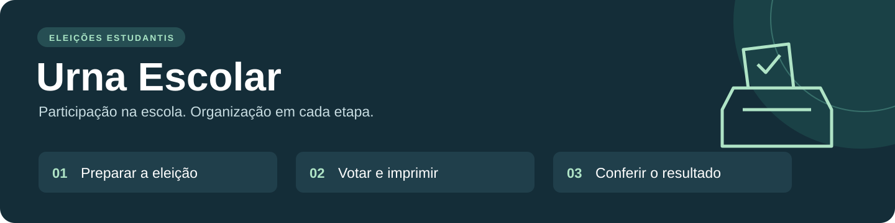
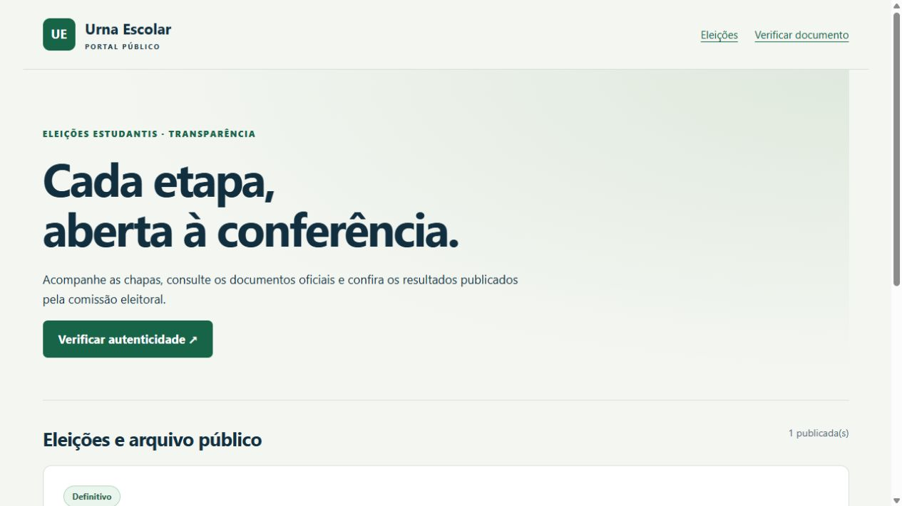
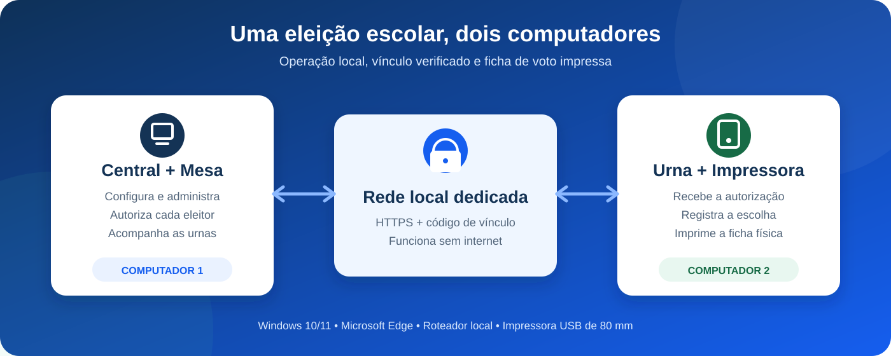

<div align="center">



# Urna Eletrônica Escolar

**Da lista de alunos ao boletim final, na rede da própria escola.**

Votação por mouse ou teclado · Ficha impressa · Operação sem internet

[](https://github.com/arturcardoalves/Urna-Eletronica-Escolar/actions/workflows/build-windows-installer.yml)


**[Baixar instalador](https://github.com/arturcardoalves/Urna-Eletronica-Escolar/actions/workflows/build-windows-installer.yml)** · **[Começar a usar](docs/GUIA_2.3.0.md)** · **[Ver as telas](docs/TELAS.md)**

[Instalação](#instalacao) · [Rede](#rede) · [Impressora](#impressora) · [Segurança](#seguranca) · [Testes](#testes) · [Dúvidas](docs/PERGUNTAS_FREQUENTES.md)

</div>

## Uma eleição, três papéis

A **Urna Eletrônica Escolar** foi criada para organizar eleições de grêmio estudantil. A comissão prepara a eleição, o mesário libera cada aluno e o eleitor escolhe sua chapa na cabine. Ao final, a equipe confere os resultados e os documentos emitidos.

| Administração | Mesa Eleitoral | Urna de votação |
|---|---|---|
| Configura a eleição, cadastra chapas e alunos e gerencia os acessos. | Identifica o aluno, libera a votação e acompanha ocorrências. | Mostra as chapas, permite conferir e corrigir a escolha e imprime a ficha. |
| No computador da Central. | No computador da Central, com acesso próprio. | No computador da cabine, com a impressora USB. |

**Para quem é:** escolas e equipes que organizam eleições estudantis. O projeto está em desenvolvimento e validação; o uso exige preparação e um ensaio completo nos equipamentos da escola. Não é um sistema eleitoral oficial certificado.

<a id="telas"></a>

## Veja a votação por mouse

Capturas da **interface oficial do projeto**, com nomes e chapas fictícios. Foram produzidas em uma prévia isolada usando os arquivos reais de interface. A autorização e a resposta da impressora foram simuladas; as imagens não comprovam uma impressão física.

<table>
  <tr>
    <td width="50%"><a href="docs/imagens/urna-aguardando.jpg"></a></td>
    <td width="50%"><a href="docs/imagens/urna-escolha.jpg"></a></td>
  </tr>
  <tr>
    <td><strong>01 · Aguarde a liberação</strong><br>A Mesa identifica o aluno e libera a cabine.</td>
    <td><strong>02 · Escolha uma chapa</strong><br>Clique na opção desejada ou em BRANCO, quando permitido.</td>
  </tr>
  <tr>
    <td><a href="docs/imagens/urna-confirmacao.jpg"></a></td>
    <td><a href="docs/imagens/urna-impressao.jpg"></a></td>
  </tr>
  <tr>
    <td><strong>03 · Confira antes de confirmar</strong><br>O botão vermelho permite corrigir. O verde confirma o voto.</td>
    <td><strong>04 · Aguarde a ficha</strong><br>O aviso de impressão permanece na própria tela de conclusão.</td>
  </tr>
</table>

**[Abrir o passeio completo pelas telas →](docs/TELAS.md)**

## Publicação pública sem conectar a eleição à internet

A Central assina a configuração, a zerésima e o BU de cada urna. Um pendrive leva os pacotes ao **Transmissor Eleitoral**, que confere a chave e solicita confirmação antes de enviar ao portal.

O mesmo instalador oferece **três funções**: Central/Administrador/Mesa, Urna e **Publicação de resultados**. No computador com internet, escolha a terceira opção e abra o atalho **Publicação de Resultados** para usar o Transmissor Eleitoral.

O portal pode funcionar gratuitamente com **GitHub + Cloudflare Workers/D1**, no endereço HTTPS `workers.dev`. Mostra chapas, PDFs, resultados por urna, pendências, totalização parcial/definitiva e histórico de versões. As urnas continuam funcionando sem internet, mesmo quando o portal está indisponível.

Os dois QR Codes permitem consulta pública e conferência criptográfica. Para reconhecer o emissor, compare a impressão digital da chave com a referência da comissão. Dados pessoais dos eleitores e votos individuais não fazem parte dos pacotes.

**[Operar publicação por pendrive](docs/PUBLICACAO_E_PORTAL.md)** · **[Configurar Cloudflare gratuito](docs/PORTAL_CLOUDFLARE.md)** · **[Conferir assinaturas e entender limites](docs/PROTOCOLO_PUBLICACAO.md)**



*Captura do Worker real em ambiente local de teste. As eleições fictícias usadas na validação não são carregadas na produção.*

## O que o sistema oferece

| Recurso | Na prática |
|---|---|
| Cadastro simplificado | Nome e turma são obrigatórios. Matrícula e turno são opcionais. Importação por CSV ou XLSX. |
| Duas formas de votar | Escolha visual por mouse/toque ou digitação do número da chapa pelo teclado. |
| Conferência da escolha | Cartão centralizado, CORRIGIR vermelho, CONFIRMAR verde e voto em branco configurável. |
| Som de conclusão | Sempre habilitado pelo sistema; o volume do Windows e as permissões de áudio do navegador continuam valendo. |
| Modos de abertura | Normal, Tela cheia e Quiosque para Mesa e Urna. |
| Documentos da eleição | Zerésima, boletim de urna e relatórios para conferência. |
| Impressão local | Driver Windows ou ESC/POS compatível, teste de ficha/assinaturas e ajuste antes do corte. |
| Recuperação | Tratamento de desconexão e de impressão incerta, com intervenção da Mesa. |
| Histórico | Arquivamento da eleição encerrada e preparação de uma nova eleição. |

<a id="instalacao"></a>

## Instalar e começar

### Separe os equipamentos

- Dois computadores com **Windows 10/11 de 64 bits** e Microsoft Edge.
- Roteador com DHCP ativo, duas portas LAN e cabos de rede.
- Impressora USB no computador da Urna, driver instalado e papel compatível. O fluxo térmico usa papel de **80 mm**.
- Fontes **Atkinson Hyperlegible Regular e Bold** instaladas nos dois computadores.
- Permissão de administrador do Windows para instalar. O uso diário pode ser feito pela conta normal.

O instalador inclui o ambiente necessário: **não é preciso instalar Python para usar o sistema**. Internet é necessária para baixar o instalador e preparar Edge, fontes e driver quando ainda não estiverem disponíveis. Depois da preparação, a votação funciona na rede local.

### Baixe o arquivo certo

1. Entre no GitHub e abra [Actions → Build Windows Installer](https://github.com/arturcardoalves/Urna-Eletronica-Escolar/actions/workflows/build-windows-installer.yml).
2. Escolha uma execução concluída com sucesso, conferindo o commit que contém a atualização desejada.
3. Em **Artifacts**, baixe **Instalador-Urna-Escolar-2.3.0** e extraia o ZIP.
4. Execute **Instalar_Urna_Escolar_2.3.0.exe**.

O download de artefatos exige uma sessão no GitHub e acesso de leitura ao repositório. [Instruções oficiais do GitHub](https://docs.github.com/en/actions/how-tos/manage-workflow-runs/download-workflow-artifacts).

**Qual arquivo escolher?** O instalador é o programa para usar. “Fonte Limpa” contém código para manutenção. “Logs-instalacao” contém registros para investigar problemas. “Download ZIP”, no botão Code, também baixa código; não entrega o instalador pronto.

### Configure os dois computadores

| Etapa | Central + Mesa | Urna + impressora |
|---|---|---|
| 1. Instalar | Escolha **Central da Eleição + Mesa Eleitoral**. | Escolha **Urna de votação + impressora USB**. |
| 2. Abrir | Aguarde **Servidor ativo — HTTPS verificado**. | Abra o aplicativo da Urna. |
| 3. Primeiro acesso | Clique **Abrir administração**, crie o ADMIN e depois o usuário MESÁRIO. | Clique **Procurar Central**. |
| 4. Vincular | Permita conexão por 5 minutos e confira o código. | Compare o código e conclua somente se corresponder. |
| 5. Preparar | Cadastre a eleição, chapas e alunos. | Configure a impressora, a margem e execute o teste completo. |
| 6. Ensaiar | Confira os cadastros, lacre e faça a abertura com zerésima. | Vote com dados fictícios e confira o papel. |

**O primeiro administrador é criado no próprio computador da Central**, pelo botão do aplicativo. Não há senha universal. A senha deve ter pelo menos 10 caracteres.

**[Guia completo, com abertura, encerramento e solução de problemas →](docs/GUIA_2.3.0.md)**

<a id="rede"></a>

## Rede: precisa configurar IP?

Em um roteador comum **com DHCP ativo**, os endereços são atribuídos automaticamente. Ligue os dois computadores por cabo às portas **LAN do mesmo roteador** e mantenha a Central aberta. O aplicativo procura e vincula a Central; normalmente não é necessário digitar um IP fixo.



| Situação | O que fazer |
|---|---|
| Windows mostra “Sem internet” | Isso pode ser normal: a eleição precisa da rede local, não de acesso à internet. Confira se a Urna conecta à Central. |
| Computadores na rede de convidados | Use uma rede que permita comunicação entre os dois equipamentos. Isolamento entre clientes impede o vínculo. |
| Cabo direto entre os dois PCs, sem roteador | É outro cenário: pode exigir configuração manual. O procedimento documentado usa roteador com DHCP. |
| A Central não aparece | Confira cabos, mesma rede, Central aberta e janela de vínculo. Peça apoio da TI em redes escolares gerenciadas. |

Para a eleição, prefira uma rede dedicada, com acesso físico controlado e sem ligação com a internet. Não faça redirecionamento de portas para a internet. A comunicação usa **TCP 8443** e a descoberta **UDP 38443**; o instalador cria regras limitadas à sub-rede local.

<a id="impressora"></a>

## Impressora: confira antes do primeiro voto

A impressora fica **conectada por USB ao computador da Urna**. Comece pelo modo **Driver Windows**; use **ESC/POS** somente se a impressora for compatível e passar no teste físico.

1. Selecione a impressora no aplicativo da Urna.
2. Comece com **30 mm de espaço em branco antes do corte**. O ajuste permite **10 a 80 mm**.
3. Execute **Imprimir teste completo de ficha, assinaturas e corte**.
4. Confira as duas amostras: texto completo, três assinaturas e corte depois do conteúdo.
5. Se necessário, aumente a margem e repita o teste. Ela vale para todas as impressões seguintes daquela Urna.

> **Se o voto não for impresso:** um voto já registrado não é desfeito pela falha da impressora. Chame o mesário, confira papel/cabo/driver e resolva a pendência pela Mesa. Não libere outro voto para “compensar”. Uma reimpressão repete a ficha do voto existente; não deve criar outro voto.

A impressão incerta não é repetida automaticamente. Recolha e controle cópias parciais ou duplicadas. “Enviado à impressora” não comprova que o papel saiu: o equipamento pode aceitar o trabalho mesmo sem papel. [Leia o procedimento de falha e recuperação](docs/GUIA_2.3.0.md#se-algo-falhar).

<a id="seguranca"></a>

## Segurança, em linguagem simples

| Proteção presente no código | O que ela ajuda a evitar |
|---|---|
| ADMIN criado no primeiro uso e senhas protegidas por hash Argon2 | Distribuição com uma senha administrativa compartilhada. |
| Perfis ADMIN/MESÁRIO e permissões verificadas no servidor | Executar operações restritas apenas abrindo uma URL ou chamando a API. |
| Vínculo aprovado e certificado próprio da instalação | Conectar a Urna a uma Central desconhecida na rede. |
| Autorização de voto consumida no registro e operação transacional | Reutilizar a mesma liberação ou duplicar um voto por repetição de requisição. |
| Voto sem nome/matrícula no registro e escolha criptografada | Exposição direta da escolha na tabela de votos. |
| Lacração, hashes e registros de auditoria | Alterações silenciosas de configuração e inconsistências verificáveis. |

**O alcance dessas proteções tem limites.** Controle administrativo do Windows, malware, observação física, ordem de atendimento, cópias de bancos e filas de impressão podem comprometer a eleição. Rede local e criptografia não garantem, sozinhas, sigilo absoluto ou ausência de fraude.

O bloqueio de repetição **por aluno** depende do cadastro e da identificação pela Mesa. No modo sem identificação, o sistema não sabe se uma pessoa voltou à cabine. Use o fluxo identificado quando precisar controlar uma participação por aluno.

**[Entenda as proteções, os limites e os cuidados com os dados →](SEGURANCA.md)**

## Termos que aparecem no sistema

| Termo | Significado |
|---|---|
| Central | Aplicativo que mantém o servidor da eleição em funcionamento. |
| Chapa | Grupo de candidatos identificado por número e nome. |
| Lacrar | Fixar a configuração e registrar sua integridade antes da abertura. Revise os cadastros primeiro. |
| Zerésima | Documento de abertura usado para conferir que ainda não há votos. |
| Boletim de Urna (BU) | Documento com os totais apurados após o encerramento. |
| Vínculo | Aprovação de um computador da Urna para trabalhar com aquela Central. |
| Hash | Uma impressão digital de um conjunto de dados. Mudanças alteram o valor; ele não prova sozinho que a eleição é legítima. |
| Quiosque | Janela com os controles do navegador ocultos. Facilita o uso da cabine, mas não bloqueia todo o Windows. |

<a id="testes"></a>

## Testes e evidências

A aprovação de uma versão depende dos testes do código **e** de um ensaio nos equipamentos que serão usados.

| Verificação | Evidência e limite |
|---|---|
| Interface JavaScript | **14 testes passaram em 12/10/2026**, incluindo escolha, rejeição, som, impressão pendente e recuperação. Usam DOM/rede simulados. |
| Cadastro simplificado | **6 testes passaram em 12/10/2026**, com SQLite em memória: cadastro, importação, duplicidade e bloqueio após lacração. |
| Aparência da votação | Navegador com a interface oficial e dados fictícios: seleção, cartão compacto, CORRIGIR, branco e conclusão. Servidor/impressora simulados. |
| Servidor, TLS e instalador | Há testes no repositório e verificações no workflow Windows. Confira o resultado da execução do **commit que vai instalar**. |
| Equipamentos da escola | Rede entre os dois PCs, som nos alto-falantes, papel, guilhotina, falta de papel e reinicialização precisam de teste presencial. |

O selo no topo aponta para o workflow. Ele não é uma certificação de segurança nem um teste da impressora da escola. A presença de um teste no repositório também não significa que ele passou em todas as versões.

**[Roteiro de ensaio e mapa dos testes →](docs/TESTES_E_VALIDACAO.md)** · [Registro técnico das revisões](docs/REVISAO_CODIGO.md)

Na entrega de publicação de 13/10/2026, **97 testes da suíte passaram**, além da validação local do Worker/D1 e do runtime Windows com Python externo fora do PATH. Confira o [relatório com resultados e limitações](docs/ENTREGA_PUBLICACAO_2026-10-13.md). Publicação na conta Cloudflare e ensaio físico continuam necessários.

## Depois do teste e antes da eleição real

- Para manter usuários e vínculos: encerre a eleição e use **Administração → Histórico → Iniciar nova eleição**. A anterior fica arquivada.
- Para apagar também senhas e configurações: use o procedimento de **reset completo**, com backup prévio se houver dados que devam ser preservados.
- Instale atualizações antes de lacrar. A atualização é bloqueada com eleição lacrada ou aberta.

**[Escolher entre nova eleição e reset completo →](docs/RESETAR_SISTEMA.md)**

## Versões e desenvolvimento

O código usa a versão **2.3.0**. Nesta revisão: cartão compacto de confirmação, CORRIGIR vermelho, som sempre habilitado, cadastro apenas com nome/turma e aviso de impressão na tela FIM/VOTOU. Confira também a data e o commit do instalador: revisões diferentes podem exibir o mesmo número de versão.

[Histórico de alterações](docs/CHANGELOG.md) · [Gerar EXE pelo GitHub ou PowerShell](docs/GERAR_EXE_NO_GITHUB.md) · [Demonstração independente com dados fictícios](demo/README.md)

<details>
<summary><strong>Para quem vai manter o código</strong></summary>

```text
.github/workflows/          Compilação Windows e artefatos
installer/                  Aplicativo Windows, instalador e pacote de fontes
tests/                      Testes de interface, servidor, impressão e instalação
portal/cloudflare/          Portal público para Workers Free + D1
transmitter/                Transmissor Eleitoral e verificador offline
docs/                       Guias e capturas revisadas com dados fictícios
demo/                       Demonstração separada; não é a eleição real
URNA_ESCOLAR_SOURCE/
  01_SERVIDOR_ADMIN/         API, banco e interfaces web
  03_URNA/                  Biblioteca de impressão
```

Para gerar o instalador localmente, use Python 3.13 x64 e Inno Setup 6 conforme o [guia de compilação](docs/GERAR_EXE_NO_GITHUB.md). Para os usuários finais, distribua o instalador pronto.

Bancos, chaves, credenciais, fotos de eleições, backups, logs e arquivos de build não devem ir ao GitHub. O empacotador aceita somente arquivos previstos e as capturas de documentação revisadas. Dados fictícios dos testes ficam separados da instalação real.

</details>

## Precisa de ajuda?

Consulte as [perguntas frequentes](docs/PERGUNTAS_FREQUENTES.md). Ao [relatar um problema](https://github.com/arturcardoalves/Urna-Eletronica-Escolar/issues), informe a versão/commit, o papel do computador, os passos e a mensagem exibida. Revise as capturas e os logs antes de anexar: não publique nomes reais de alunos, senhas, tokens, bancos ou chaves.
