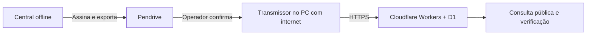

# Publicação por pendrive e portal público

No computador com internet, use o instalador unificado e escolha **Publicação de resultados — Transmissor Eleitoral**. Ele cria o atalho **Publicação de Resultados**. O EXE independente continua opcional; não é necessário obter outro instalador para publicar.

[← Projeto](../README.md) · [Hospedagem gratuita](PORTAL_CLOUDFLARE.md) · [Protocolo e segurança](PROTOCOLO_PUBLICACAO.md)

## O que acontece em cada etapa

A eleição permanece na rede local, sem internet. O portal recebe arquivos públicos; não acessa o servidor eleitoral, o banco de eleitores, as autorizações nem os votos individuais.



| Etapa | Documento exportado | Momento da liberação |
|---|---|---|
| Configuração | Configuração pública e lacração | Após lacrar com publicação habilitada. |
| Abertura | Zerésima de cada urna | Após o agente confirmar a impressão daquela versão. |
| Encerramento | BU de cada urna e suas contagens | Após encerrar, apurar e confirmar a impressão daquela versão. |

O portal exige configuração antes da zerésima e a zerésima correspondente antes do BU. Exibe resultados parciais enquanto faltarem BUs; passa a definitivo quando todas as urnas previstas tiverem documentos aceitos. Até três urnas são suportadas, conforme a arquitetura existente.

## Antes da lacração

1. Prepare o portal seguindo o [guia Cloudflare](PORTAL_CLOUDFLARE.md). O endereço gratuito `https://…workers.dev` pode ser o definitivo; não é necessário comprar domínio.
2. Na Administração, abra **Publicação e mídia USB** e salve esse endereço HTTPS, sem caminho nem parâmetros.
3. A Central gera uma chave Ed25519 exclusiva. Copie o identificador da eleição e a impressão digital da chave pública para cadastrar a referência no portal. Compare por um canal confiável.
4. Confira escola, nome, chapas, integrantes, fotos e urnas. Clique **Finalizar configuração e lacrar eleição**.
5. Insira uma mídia USB removível na Central. Havendo exatamente uma, a Central aberta copia os documentos pendentes automaticamente. Havendo várias, escolha a mídia no painel.

Sem endereço definitivo, mantenha a publicação desabilitada. A eleição local continua disponível, mas não produzirá os dois QR Codes nem os pacotes de publicação. Uma eleição já lacrada não pode receber outro endereço sem nova configuração/eleição: isso alteraria os documentos assinados.

## Exportação e impressão

Os pacotes ficam em `UrnaEscolar_Publicacao/<ID-eleicao>/<ID-documento>.uepkg` no pendrive. Não há execução automática de programas da mídia.

O pacote inclui manifesto assinado, PDF e imagens públicas das chapas, sem metadados EXIF da foto original. A lista de campos exportados é restrita: nomes de eleitores, matrículas, senhas, sessões e votos individuais não fazem parte do formato.

Cada zerésima/BU térmico tem dois QR Codes, empilhados para ocupar a largura útil de 80 mm:

- **Consulta pública:** abre a página daquele documento; antes da transmissão ela informa que o documento ainda não chegou.
- **Verificação digital:** contém no fragmento do endereço um resumo Ed25519 assinado. O texto desse fragmento também pode ser verificado offline, independentemente do portal.

A margem antes do corte continua aplicada pelo agente de impressão. Os QR Codes têm área branca de quatro módulos e no mínimo quatro pixels por módulo no raster de 576 pontos. A leitura automatizada dos rasters não substitui impressão física com o driver, papel e celular da escola.

Se a impressão falhar, resolva e reimprima pelo fluxo existente. O documento dessa urna continua pendente para USB até a confirmação de impressão. Isso não cria outro voto. Uma falha de pendrive preserva o pacote no banco local; reconecte uma mídia e repita.

## Transmissor Eleitoral

Execute **TransmissorEleitoral.exe** no computador com internet. Ele é independente da instalação da Central e da Urna e não precisa de Python no destino.

1. Insira o pendrive; os pacotes são detectados automaticamente. Também é possível abrir um `.uepkg` manualmente.
2. Informe endereço do portal, UUID da eleição, impressão digital confiável da chave e credencial fornecida pelo responsável pelo portal.
3. Use **Verificar selecionado** para conferir sem internet e comparar os dados com o papel.
4. Selecione os documentos, clique **Transmitir selecionados** e confira a lista e o destinatário na confirmação.
5. O envio ocorre na ordem configuração → zerésimas → boletins, mantendo a ordem das revisões.
6. Guarde os comprovantes em `%LOCALAPPDATA%\UrnaEscolarTransmissor`. Cada um contém protocolo, horário UTC, ID do documento e SHA-256 do pacote.

A credencial fica somente na memória durante essa execução. Endereço, UUID e impressão digital podem ser lembrados; o programa não grava a credencial em texto simples. Feche a janela somente após os envios terminarem.

Se a rede cair depois de o portal gravar, repita o envio. O mesmo pacote retorna o mesmo protocolo original; não duplica contagens. Os arquivos do pendrive não são apagados pelo transmissor.

## Reexportação, notas e recuperação

**Exportar documentos prontos**, no painel administrativo, copia novamente os bytes originais: assinatura, data, PDF e conteúdo permanecem idênticos. Um arquivo de mesmo ID com bytes diferentes na mídia é recusado.

Uma **nota de retificação** cria novo ID e revisão, encadeados pelo hash do documento anterior. Nesta implementação, retificação acrescenta uma explicação; não altera configuração lacrada, contagens ou evidências do encerramento. A nova zerésima/BU é enviada para impressão e só então liberada para USB. Transmita todas as revisões na sequência. O portal mantém as versões anteriores.

| Ocorrência | Como recuperar |
|---|---|
| Portal/internet indisponível | Continue a eleição offline. Preserve os pacotes e transmita depois. |
| USB cheio ou removido | Troque/reconecte a mídia e exporte novamente pelo painel. |
| Pacote adulterado/chave diferente | Não publique. Reexporte da Central e confirme a chave com a comissão. |
| Documento fora de ordem | Envie configuração, zerésima e versões anteriores antes do documento pendente. |
| Credencial revogada | Solicite nova credencial ao responsável; a chave da eleição lacrada permanece a mesma. |
| Chave privada perdida | Os documentos já assinados continuam verificáveis. Novos documentos daquela chave não podem ser assinados; não substitua a identidade silenciosamente. Preserve dados e trate a recuperação com a comissão. |
| Limite do plano gratuito | Preserve mídia e comprovantes. Consulte métricas e backups do portal; não apague versões para forçar publicação. A votação local não depende desse limite. |

No Windows, a chave privada usa DPAPI do usuário que executa a Central. A recuperação exige preservar o perfil Windows e os dados protegidos; copiar apenas o arquivo `.key` para outro usuário não garante recuperação. Faça backup seguro e ensaie a restauração antes da eleição. Fora do Windows, a execução por fonte exige `URNA_PUBLICATION_KEY_PASSWORD` externa, com pelo menos 16 caracteres.

## Construir pelo PowerShell

Preparação/build exige internet, Python 3.13, Node.js 24 e Inno Setup 6. O uso dos EXEs gerados não depende de Python/Node externos.

```powershell
Set-Location 'C:\Users\Notebook\Desktop\ARTUR\URNA ELETRONICA CHATGPT\Repositorio_HTTPS_Atualizado'
.\installer\BUILD_WINDOWS.ps1
.\installer\BUILD_TRANSMITTER.ps1
```

O instalador fica em `installer/output`; o transmissor separado fica em `dist/TransmissorEleitoral.exe`. O Actions gera ambos como artefatos. Nunca compile ou atualize uma instalação com eleição lacrada/em andamento; use a cópia de desenvolvimento e o procedimento de atualização existente.


## Página inicial e verificação pela câmera

O portal mostra diretamente a última eleição cuja configuração foi transmitida, sem catálogo de eleições. A seleção usa a primeira transmissão da configuração; retificações de eleições anteriores não mudam a eleição atual. Sem configuração, ou quando todos os BUs da eleição atual já foram publicados, a página inicial mostra **Não há votações no momento.** Não há consulta em tempo real ao servidor offline: enquanto faltar um BU, o portal acompanha a eleição atual e identifica resultados parciais. Documentos e resultados anteriores permanecem acessíveis pelos seus endereços e QR Codes.

O verificador público usa somente a câmera: toque em **Abrir câmera**, permita o acesso e escaneie o QR de verificação. Não há digitação de códigos ou envio de arquivos. Imagens são processadas no dispositivo pelo jsQR 1.4.0 (licença Apache-2.0 incluída), sem CDN. Depois da leitura a câmera é desligada; também é desligada ao ocultar ou sair da página. HTTPS é necessário fora de localhost.

O QR assinado é conferido localmente com Ed25519. O navegador busca somente o manifesto público neste mesmo portal e confere assinatura, identificadores, revisão e hash dos dados contra o QR, exibindo contagens para comparação com o papel. O QR de consulta também é reconhecido, mas o usuário é orientado a ler o de verificação. Endereços de outros sites não são abertos. Se o portal estiver indisponível, o resumo pode ter assinatura válida, mas a identidade da chave e os valores não são apresentados como confirmados. O Transmissor continua oferecendo verificação independente dos pacotes, sem internet.
