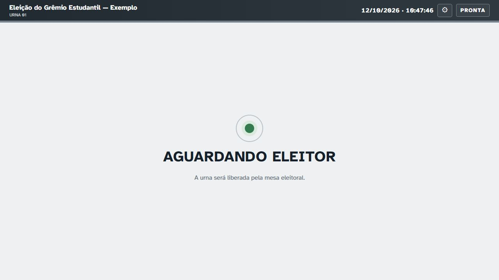
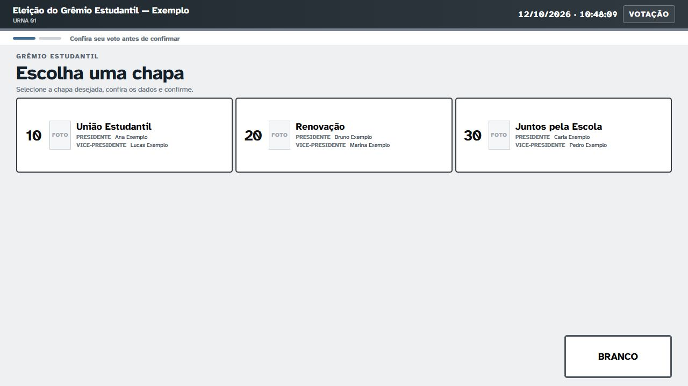
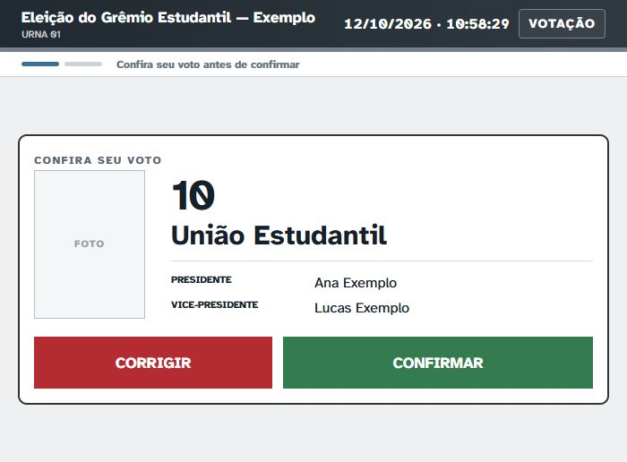
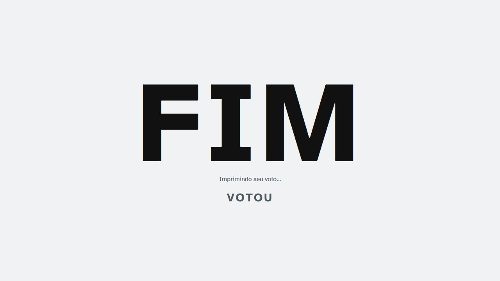

# Conheça a votação por mouse

[← Página do projeto](../README.md) · [Instalar e usar](GUIA_2.3.0.md)

Estas capturas usam a interface oficial do código 2.3.0, com dados fictícios e respostas de servidor/impressão simuladas. A imagem de confirmação já inclui o cartão compacto e o botão CORRIGIR vermelho. Não são telas do mini executável de demonstração.

## 1. Aguardando o eleitor

A cabine aguarda enquanto o mesário identifica o aluno e libera sua votação. A Central precisa continuar aberta no outro computador.

## 2. Escolha da chapa

O eleitor clica no cartão da chapa. O botão BRANCO aparece quando essa opção está permitida. As áreas FOTO ficam reservadas para as imagens cadastradas; nesta documentação não foram usadas fotografias de pessoas.

## 3. Conferência e confirmação

O cartão centralizado mostra número, nome e integrantes. **CORRIGIR**, em vermelho, volta à escolha. **CONFIRMAR**, em verde, envia o voto. Clicar apenas em uma chapa ainda não confirma o voto.

## 4. Conclusão e impressão

O sistema mostra **FIM / VOTOU** e mantém o aviso de impressão na mesma tela. Aguarde a ficha e siga a orientação para dobrar e depositar. Se houver uma falha, chame o mesário; não tente votar de novo.

A imagem mostra o estado “Imprimindo seu voto…” com uma resposta simulada da impressora. Para conferir impressão, corte e recuperação reais, siga o [roteiro presencial](TESTES_E_VALIDACAO.md).

## Outras formas de usar

A urna também oferece digitação pelo teclado. Os atalhos padrão são Enter para confirmar, Backspace para corrigir e B para branco; confira as teclas configuradas na sua eleição. Mesa e Urna podem abrir em modo Normal, Tela cheia ou Quiosque.

Os desenhos antigos dos painéis [Central](imagens/painel-central.svg) e [Urna](imagens/painel-urna.svg) são ilustrações de apoio. Não são capturas e podem não refletir cada detalhe da versão instalada.
